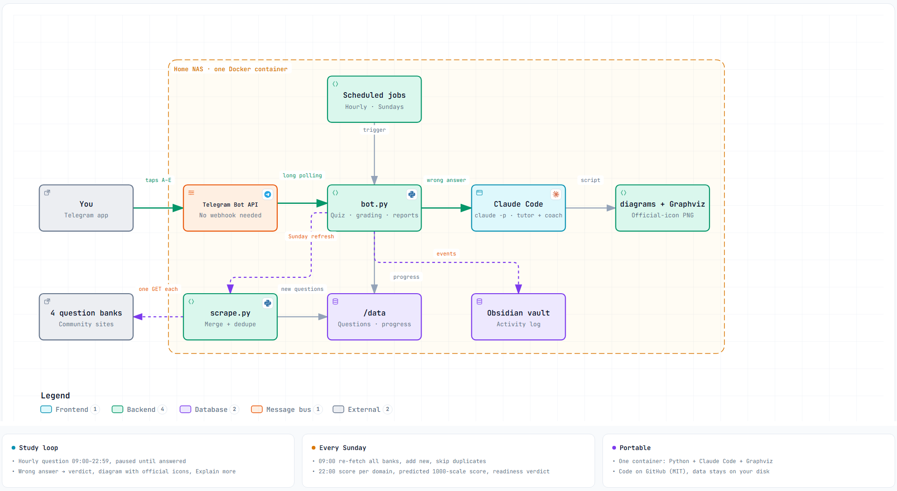

# Claude Certified Architect — Professional Portable

A self-hosted Telegram study bot for Anthropic's **Claude Certified Architect – Professional (CCAR-P)** exam. It drills you with community practice questions, draws an architecture diagram with official provider icons when you get one wrong, tracks your progress, and tells you every Sunday whether you are ready to sit the exam.

"Portable" because the whole thing is one container: drop it on any machine with Docker (a home NAS, a VPS, a laptop), give it a Telegram bot token and a Claude Code login, and study from your phone.

> Unofficial and independent. Not affiliated with or endorsed by Anthropic. The question banks are community-written practice sets, not real exam items.



*Interactive version with pan, zoom, search and relationship tracing: open [`docs/architecture.html`](docs/architecture.html) in a browser.*

## What you get

| | |
|---|---|
| **1,815 questions** | Merged from 22 community and paid sources, deduplicated; 138 come from Tutorials Dojo (ids `TD-001..`, `source` = Tutorials Dojo, never pushed or shown publicly). The four fetched live each Sunday are [claudearchitects.org](https://claudearchitects.org/mockexams/CCAR-P), [open-exam-prep.com](https://open-exam-prep.com/practice/anthropic-ccar-p), [learn.techwithdarin.com](https://learn.techwithdarin.com/certs/claude-architect-professional/) and [szymonpaluch.com](https://szymonpaluch.com/claude-certified-architect-professional-practice-exam); the rest are downloaded files in `sources/online/`. Pruned to exam-like scenario questions; removed ones are archived in `data/removed_questions.csv` with the reason. All seven official domains, single and multi-response. |
| **One tap to answer** | One full-width button per option. "Select two" questions tick, then ✅ Submit. |
| **Right** | Verdict + the bank's explanation + a 🎓 *Explain more* button (Claude is only called if you tap it). |
| **Wrong** | Verdict + explanation, then an **architecture or flow diagram** drawn by Claude and rendered with [`diagrams`](https://diagrams.mingrammer.com) + Graphviz using **official AWS / GCP / Azure / Kubernetes icons** (Mermaid for pure decision rules). 🎓 *Explain more* reveals the tutor text, already generated, so it costs nothing. |
| **Hourly drill** | A question every `QUIZ_EVERY_MIN` minutes inside `QUIZ_HOURS` (default 09:00–22:59), only after you answered the previous one. `/quiz` works any time. |
| **Sunday 09:00 · refresh** | Re-fetches every bank, adds new questions, skips duplicates (same id or same question text), posts a 🆕 report. Ids never change, so progress survives. `/refresh` on demand. |
| **Sunday 22:00 · report** | This week's right/wrong, first-try accuracy per domain, a predicted score on the 1000 scale (domain accuracy weighted by the official blueprint, pass mark 720), a readiness verdict, and a short Claude coach note naming the two domains to drill next. `/report` on demand. |
| **Smart picker** | Unseen questions first, then the ones you got wrong, then everything. `/stats` shows coverage per domain. |
| **Memory** | Optional Obsidian vault: one Markdown line per event in `Activity/YYYY/MM/YYYY-MM-DD.md`. |

### Commands
`/quiz` `/explain` `/report` `/stats` `/refresh` `/reset` `/whoami`

## How it works

1. **Telegram** — `python-telegram-bot` with long polling, so no public URL or webhook is needed. Replies can go to your DM or to one topic in a group (`BOT_CHAT=chat_id/topic_id`).
2. **Claude** — every AI call is a one-shot `claude -p` (Claude Code in headless mode) with the prompt on stdin, no tools, a JSON schema for `{teach, kind, code}`. Sign in with a Claude subscription token (`claude setup-token`) or an `ANTHROPIC_API_KEY`.
3. **Diagrams** — Claude writes a small Python script for the `diagrams` library. The bot runs it with `python -I` in a temp directory, allows imports from `diagrams.*` only, kills it after 60 s, and posts the PNG. Mermaid diagrams go through mermaid.ink.
4. **Question bank** — `scrape.py` has one parser per source (each site embeds its questions in the page, so a single GET is enough). `refresh()` merges into `data/questions.csv` and dedupes. Run it once at setup; the Sunday job keeps it current.
5. **State** — `data/state.json`: right/wrong counts per question, the pending auto question, the last answer, and an answer log used by the weekly report.

## Quick start

```sh
git clone https://github.com/gcjk768/claude-certified-architect-professional-portable.git
cd claude-certified-architect-professional-portable
cp bot.env.example bot.env          # fill in the values below
python scrape.py                    # builds data/questions.csv (611 rows)
docker compose up -d --build        # first build takes a few minutes (installs Claude Code + Graphviz)
```

Then open your bot in Telegram and send `/start`.

### `bot.env`

| Key | What |
|---|---|
| `TELEGRAM_BOT_TOKEN` | From [@BotFather](https://t.me/BotFather) → `/newbot`. |
| `ALLOWED_USER_IDS` | Your Telegram user id. Send `/whoami` to the bot to get it. The bot ignores everyone else. |
| `CLAUDE_CODE_OAUTH_TOKEN` | Run `claude setup-token` on a machine where Claude Code is logged in and paste the result. Or set `ANTHROPIC_API_KEY`. |
| `CLAUDE_MODEL` | `sonnet` (default) or `haiku` for cheaper tutoring. |
| `BOT_CHAT` | Optional `chat_id/topic_id` to post into a group topic instead of your DM. Add the bot to the group first. |
| `QUIZ_EVERY_MIN`, `QUIZ_HOURS` | Auto-question cadence and window (local time of the container, `TZ`). `0` disables it. |
| `VAULT_DIR` | `/vault` to enable the Obsidian log. Point `VAULT_HOST_DIR` in a `.env` next to `compose.yaml` at your vault folder on the host. |
| `PUID`, `PGID` | The user the container runs as, so `./data` stays owned by you. |

### Running without Docker
`python -m pip install -r requirements.txt`, install Graphviz, put the variables above in your environment, and run `python bot.py`. On Windows `run.ps1` does that from `bot.env`. Only one copy may poll a bot token at a time.

## Cost
One Claude call per wrong answer and one per weekly report. Measured with Sonnet: about US$0.10–0.50 per wrong answer. Switch `CLAUDE_MODEL=haiku` to cut it several-fold.

## Files

| File | Purpose |
|---|---|
| `bot.py` | The bot: questions, grading, tutor, diagrams, jobs, weekly report. |
| `scrape.py` | Source parsers and the merge/dedupe into `data/questions.csv`. |
| `test_bot.py` | `python test_bot.py`: parsing, buttons, picker, diagram guard, schedule window, report metrics. |
| `Dockerfile`, `compose.yaml` | The container. Installs Claude Code and Graphviz. |
| `docs/architecture.archify.json`, `docs/architecture.html` | Source and interactive build of the diagram above ([Archify](https://github.com/tt-a1i/archify)). |
| `assets/claude.png` | Claude logo used as the Claude node in generated diagrams. |

## Adding a question source
Add a function in `scrape.py` that returns rows via `_row(id, domain, question, options, correct, explanation, source)` and append it to `SOURCES`. Use a stable id prefix. Respect the site's robots.txt and keep it to one request per refresh.

## Licence
MIT for the code. The questions belong to their respective sites and are fetched at run time; they are not redistributed in this repository.
